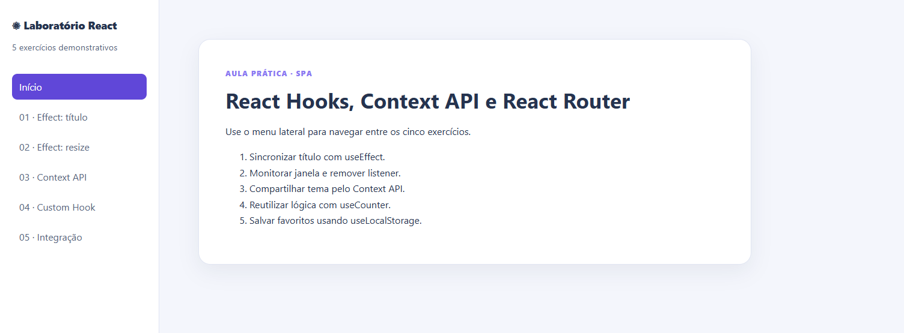

<div align="center">

# Laboratório React

**Cinco exercícios para aprender Hooks, Context API e navegação na prática.**

Uma aplicação de página única que conecta estado, efeitos, lógica reutilizável e persistência no navegador.

**React 19 · React Router 7 · Vite 7 · JavaScript**

[Sobre](#sobre) · [Interface](#interface) · [Exercícios](#exercícios) · [Como executar](#como-executar) · [Estrutura](#estrutura-do-projeto)

</div>

## Sobre

Este projeto é um laboratório de estudos com exemplos pequenos e interativos. Cada página explora um conceito do React, permitindo observar o comportamento da aplicação enquanto você interage com ela.

O menu lateral conecta os cinco exercícios sem recarregar a página. O tema é compartilhado entre as rotas, e os favoritos ficam armazenados no navegador.

## Interface



<p align="center"><sub>Tela inicial com navegação lateral e acesso aos cinco exercícios do laboratório.</sub></p>

<p align="center"><a href="https://vitorcgo.github.io/react-hooks-lab-tsi/">Acessar o laboratório</a></p>

## Exercícios

| Exercício | Conceitos | O que experimentar |
| :--- | :--- | :--- |
| **01 · Título da aba** | `useState`, `useEffect` e limpeza de efeitos | Clique no contador e observe o título da aba mudar. |
| **02 · Largura da janela** | Eventos do navegador e remoção de listeners | Redimensione a janela e acompanhe a largura em pixels. |
| **03 · Tema compartilhado** | Context API e `useContext` | Alterne entre claro e escuro e navegue pelas outras páginas. |
| **04 · Contadores independentes** | Custom hooks e reutilização de lógica | Use dois contadores com valores iniciais diferentes. |
| **05 · Favoritos persistentes** | `localStorage`, efeitos e integração com contexto | Favorite tecnologias e recarregue a página para conferir os dados salvos. |

### Detalhes que fazem parte da prática

- O exercício de título começa em zero e restaura um título padrão ao sair da página.
- O monitor de largura mostra **Mobile** abaixo de 768 pixels e **Desktop** a partir desse valor.
- O tema permanece ativo durante a navegação e volta para claro ao recarregar a aplicação.
- Os contadores começam em **0** e **10**. O botão **Restaurar** retorna cada um ao seu valor inicial.
- Os favoritos usam a chave `lab-favoritos` no `localStorage` e permanecem salvos entre visitas no mesmo navegador e origem.

## Como executar

### Pré-requisitos

- Node.js 22.12 ou superior.
- npm disponível no terminal.

### Instalação

Clone o repositório e entre na pasta:

```bash
git clone https://github.com/vitorcgo/react-hooks-lab-tsi.git
cd react-hooks-lab-tsi
```

Instale as dependências:

```bash
npm install
```

Inicie o servidor de desenvolvimento:

```bash
npm run dev
```

Abra o endereço informado no terminal, normalmente `http://localhost:5173/react-hooks-lab-tsi/`.

## Comandos disponíveis

| Comando | Função |
| :--- | :--- |
| `npm run dev` | Inicia o ambiente de desenvolvimento com atualização automática. |
| `npm run lint` | Verifica o código com ESLint e as regras de React Hooks. |
| `npm run build` | Gera os arquivos de produção na pasta `dist/`. |
| `npm run preview` | Serve localmente o resultado do build para conferência. |

Para conferir a versão de produção:

```bash
npm run build
npm run preview
```

## Estrutura do projeto

```text
src/
├── main.jsx
├── App.jsx
├── styles.css
├── assets/
│   └── react.svg
├── context/
│   └── ThemeContext.jsx
├── hooks/
│   ├── useCounter.js
│   └── useLocalStorage.js
└── pages/
    ├── Home.jsx
    ├── Ex01Titulo.jsx
    ├── Ex02Resize.jsx
    ├── Ex03Context.jsx
    ├── Ex04Counter.jsx
    └── Ex05Favoritos.jsx
```

| Arquivo ou pasta | Responsabilidade |
| :--- | :--- |
| `main.jsx` | Inicializa o React e envolve a aplicação com o provedor de tema e o roteador. |
| `App.jsx` | Organiza o layout, o menu de navegação e as rotas. |
| `styles.css` | Define o visual responsivo e as cores dos temas claro e escuro. |
| `context/` | Disponibiliza o tema e a função de alternância para as páginas. |
| `hooks/` | Reúne a lógica reutilizável de contagem e persistência. |
| `pages/` | Contém a apresentação e os cinco exercícios. |

## Rotas

| Caminho | Página |
| :--- | :--- |
| `/` | Apresentação do laboratório |
| `/exercicio-1` | Contador e título da aba |
| `/exercicio-2` | Monitor de largura |
| `/exercicio-3` | Context API e tema |
| `/exercicio-4` | Contadores com `useCounter` |
| `/exercicio-5` | Favoritos com `useLocalStorage` |

Endereços não cadastrados exibem a mensagem de página não encontrada.

## Tecnologias

- **React e React DOM:** componentes, renderização e gerenciamento de estado.
- **React Router:** navegação entre páginas com `HashRouter`, `Routes` e `NavLink`.
- **Vite:** servidor de desenvolvimento e geração do build.
- **ESLint:** análise estática e verificação das regras de Hooks.
- **CSS:** layout responsivo, cartões e variáveis para os temas.
- **Web Storage API:** persistência local dos favoritos.

## Publicação

O workflow `.github/workflows/deploy.yml` instala as dependências, executa o lint, gera o build e publica a pasta `dist/` no GitHub Pages a cada push na branch `main`. Também é possível iniciá-lo manualmente pela aba **Actions**.

No repositório, acesse **Settings > Pages > Build and deployment** e selecione **GitHub Actions** no campo **Source**.

Após o primeiro deploy, o site estará disponível em:

https://vitorcgo.github.io/react-hooks-lab-tsi/

As rotas usam `HashRouter`, com endereços como `/#/exercicio-1`, permitindo abrir links diretos e recarregar a página no GitHub Pages. O Vite usa a base `/react-hooks-lab-tsi/` para carregar os arquivos do projeto.

## Autor

Desenvolvido por [Vitor Gomes](https://github.com/vitorcgo) como projeto de estudo de React.
